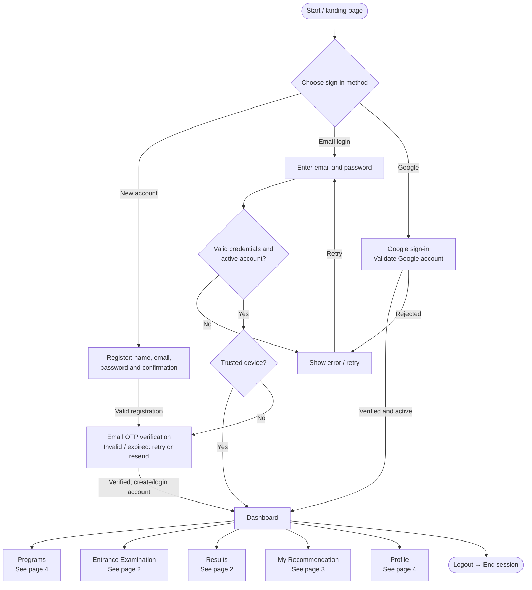
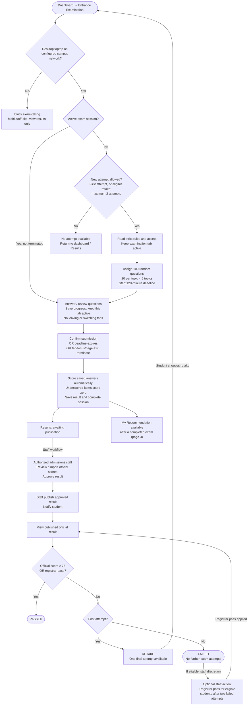
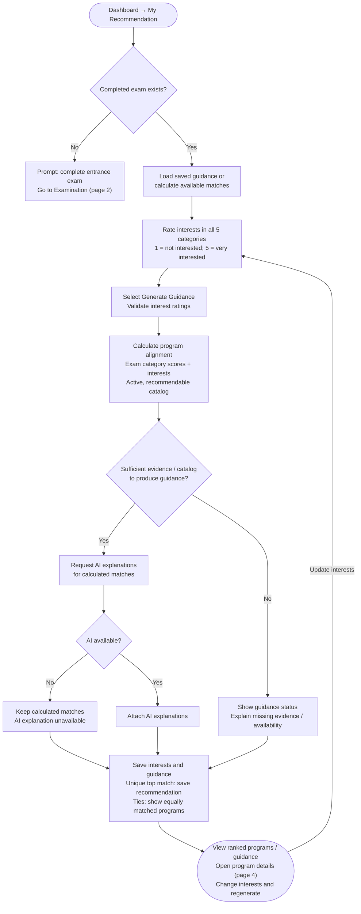
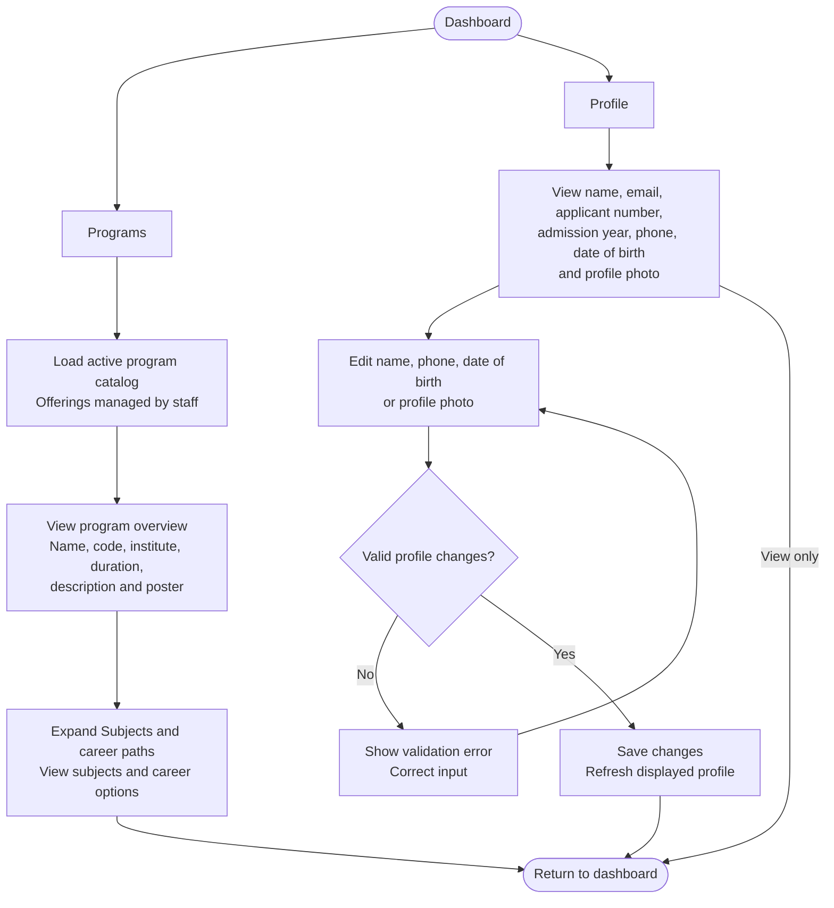

# Current system flowchart

Based on the current repository code, reviewed 27 September 2026. Scope: student portal and the staff actions that affect student results. This is not a full administrator-module diagram. Live database contents and deployed configuration were not inspected.

Open `current-system-flowchart.drawio` in Draw.io / diagrams.net. It contains four editable pages. The diagrams below describe the same flows.

Rectangles are processes, diamonds are decisions, and rounded nodes are starts, ends, or navigation endpoints. Program guidance does not require official result publication and does not determine admission. For registrar-pass results, exact performance details are suppressed in student guidance.

## 1 - Access and dashboard

## 2 - Examination and official results

## 3 - Program recommendation

## 4 - Programs and profile

## Code references

- `frontend/src/router/index.js`: student pages and authentication routing.
- `backend/app/Http/Controllers/AuthController.php`: registration, login, OTP, trusted devices and Google sign-in.
- `backend/app/Services/ExamSessionService.php`: assignment, timer, saved answers, scoring and attempt limits.
- `backend/app/Models/ExamResult.php`: official outcomes and retake eligibility.
- `backend/app/Http/Controllers/ResultReviewController.php`: result approval and publication.
- `backend/app/Http/Controllers/ResultController.php`: calculated guidance, AI explanations, persistence and registrar-pass redaction.
- `frontend/src/pages/Programs.vue` and `frontend/src/pages/Profile.vue`: catalog and profile fields.

